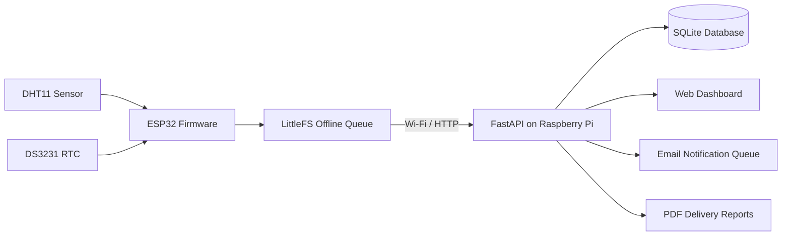

# Meridian Cold-Chain Monitor

An embedded IoT project for collecting, buffering, transmitting, and reviewing temperature readings during simulated cold-chain deliveries.

The system uses an **ESP32**, a **DHT11 temperature/humidity sensor**, and a **DS3231 real-time clock** to collect readings every five seconds. Readings are first saved to the ESP32's internal flash using LittleFS, then uploaded over Wi-Fi to a **Raspberry Pi 4** running a **FastAPI** backend and **SQLite** database. A browser-based dashboard displays device telemetry, alerts, delivery history, and downloadable PDF reports.

> **Prototype disclaimer:** This is a portfolio project, not a validated pharmaceutical monitoring instrument. The DHT11 is a low-cost sensor and is not suitable for demonstrating medication safety or regulatory compliance. A `PASS` result means only that none of the readings received by the backend were outside the configured range. Missing readings and telemetry gaps represent unknown monitoring coverage; they do not prove that temperatures remained safe.

## Highlights

- **Embedded data collection:** ESP32 firmware reads temperature and humidity every five seconds.
- **Real-time timestamps:** DS3231 timestamps are represented as ISO 8601 UTC values.
- **Offline buffering:** LittleFS stores readings locally when Wi-Fi or the backend is unavailable.
- **Retry-safe ingestion:** Unique record IDs and per-device sequence numbers support idempotent uploads and duplicate detection.
- **Telemetry-gap tracking:** Missing sequence numbers are recorded, and late-arriving readings can recover previously detected gaps.
- **Configurable temperature thresholds:** Minimum and maximum Fahrenheit thresholds are configurable per device.
- **Email notifications:** Temperature alerts and recovery notifications are queued and retried when SMTP is configured.
- **Delivery tracking:** Start and complete delivery records and review their readings and temperature statistics.
- **PDF reports:** Download a delivery report containing the result, temperature summary, out-of-range readings, and telemetry gaps.
- **Automated backend tests:** API behavior is covered by a pytest test suite and a GitHub Actions workflow.

## System architecture



### Data flow

1. The ESP32 samples the DHT11 at the configured interval.
2. The DS3231 provides the reading timestamp.
3. The firmware writes the reading to the LittleFS queue before attempting transmission.
4. When the network is available, the ESP32 posts queued readings to `POST /api/v1/readings`.
5. The API validates the payload and stores it in SQLite. Duplicate retries are acknowledged without inserting duplicate rows.
6. The dashboard requests device, reading, alert, gap, and delivery information from the API.
7. Completed deliveries can be reviewed and exported as PDF reports.

## Hardware

### Components

| Component | Purpose |
|---|---|
| ESP32-DevKitC-VIE development board | Main microcontroller and Wi-Fi connectivity |
| DHT11 module | Temperature and relative-humidity readings |
| DS3231 RTC breakout | Wall-clock timestamps |
| Breadboard and jumper wires | Prototyping connections |
| USB data cable | Power, firmware upload, and serial monitoring |
| Raspberry Pi 4 | Hosts the API, SQLite database, and dashboard |

The project uses the ESP32's internal flash for offline storage; **a microSD module is not required**.

### ESP32 wiring

| Module | Pin | ESP32 connection |
|---|---|---|
| DHT11 module | VCC / `+` | 3V3 |
| DHT11 module | DATA / `S` / `OUT` | GPIO 5 |
| DHT11 module | GND / `-` | GND |
| DS3231 | VCC | 3V3, only if supported by the exact breakout |
| DS3231 | GND | GND |
| DS3231 | SDA | GPIO 21 |
| DS3231 | SCL | GPIO 22 |

Check the labels and electrical requirements on your exact breakout boards before connecting them. Some DHT11 modules include a DATA pull-up resistor; if yours does not, add a 4.7 kΩ–10 kΩ resistor between DATA and 3V3. Confirm that the DS3231 breakout's I²C pull-ups are compatible with 3.3 V logic. Its typical I²C address is `0x68`.

**Disconnect USB power before changing wiring.** More detailed notes are in [`hardware/README.md`](hardware/README.md) and [`hardware/pinout.md`](hardware/pinout.md).

### ESP32 wiring image


## Software stack

| Layer | Technology |
|---|---|
| Microcontroller | ESP32 / Arduino framework |
| Firmware language | C++ |
| Firmware build system | PlatformIO |
| Sensor | DHT11 |
| Real-time clock | DS3231 / RTClib |
| Offline storage | LittleFS |
| Device communication | Wi-Fi and HTTP REST |
| Backend | Python, FastAPI, Pydantic |
| Database | SQLite |
| Dashboard | HTML, CSS, JavaScript |
| PDF generation | ReportLab |
| Deployment | Docker Compose or direct Python/Uvicorn |
| Backend tests | pytest and httpx |

## Repository structure

```text
.
├── backend/
│   ├── app/main.py          # FastAPI application, database logic, reports
│   └── tests/test_api       # API and behavior tests
├── firmware/
│   ├── platformio.ini
│   ├── include/
│   └── src/                  # Modular ESP32 firmware
├── frontend/
│   ├── index.html
│   ├── css/style.css
│   └── js/dashboard.js
├── hardware/                 # Bill of materials and wiring references
│   ├──README.md
│   └── pinout.md
└── README.md

```


## Delivery results and PDF reports

The dashboard supports one active delivery per ESP32. Start a delivery with a unique delivery ID before monitoring begins. After the delivery, review the readings and complete the delivery to generate its final result. A PDF report can be downloaded from the delivery history or detail view.

### Result rules

| Result | Meaning |
|---|---|
| `IN_PROGRESS` | The delivery has not been completed. |
| `PASS` | 	No observed out-of-range episode lasts at least the configured excursion duration. Brief spikes do not fail a delivery. |
| `FAIL` | 	At least one observed out-of-range episode spans the configured excursion duration or longer. |

**One shared duration setting:** `excursion_duration_seconds` governs both email alert confirmation and delivery PASS/FAIL. The default is **120 seconds**. When a delivery starts, its minimum/maximum thresholds and excursion duration are saved with that delivery; changing settings later does not retroactively change its rules.

The report sorts received readings by their measurement timestamps and groups consecutive out-of-range readings into episodes. An in-range reading ends an episode. The episode duration is the elapsed time between its first and last observed out-of-range timestamps; a lone out-of-range reading has a measured duration of zero seconds. For example, with a 30-second setting, out-of-range readings at 12:00:00 and 12:00:30 in the same episode cause FAIL, while a brief spike followed by an in-range reading does not.

**Coverage caveat:** No maximum sample-gap rule is enforced. Two out-of-range observations separated by missing telemetry can count toward the elapsed duration, but missing data cannot prove that the temperature stayed out of range between them. Review gap warnings when interpreting results.

**Telemetry gaps do not independently change PASS/FAIL.** Missing sequence numbers, unresolved gaps, incomplete coverage, an empty delivery, or an unconfirmed queue-drain checkbox do not by themselves cause a failure. Gaps are still shown as informational coverage warnings in the dashboard and PDF. Therefore, `PASS` does not establish that the temperature remained in range during periods when no reading was received, or that no brief excursion occurred.

### Important delivery-association limitation

The current ESP32 firmware does not store and transmit a `delivery_id` with each queued reading. Instead, the backend associates a reading with whichever delivery is active for that device when the reading arrives.

**Before completing a delivery, reconnect the ESP32 and allow its LittleFS backlog to upload. Do not start the next delivery until the previous delivery's queue has drained.** Otherwise, delayed readings from the previous trip could be associated with the next delivery. Persisting a delivery ID in every queued firmware record is a planned improvement.

## Temperature thresholds and email alerts

The illustrative default temperature range is **35–45 °F**. Thresholds are configurable per device through the dashboard or API. The default shared excursion duration is **120 seconds**.

The **same `excursion_duration_seconds` setting** applies to email alerts and delivery results:

- An out-of-range reading starts a potential alert period.
- A later out-of-range reading after the configured duration can confirm an email alert.
- An in-range reading resets an unconfirmed email alert timer and breaks a delivery-report excursion episode.
- A completed delivery fails only when an observed out-of-range episode spans at least the configured duration.
- Email alerts are processed as readings arrive; delivery reports evaluate stored measurement timestamps. As a result, alert notification timing and report evaluation are related but not identical.

To enable email notifications, configure these environment variables for the backend service:

```text
ALERT_EMAIL_TO=operator@example.com
ALERT_EMAIL_FROM=meridian@example.com
SMTP_HOST=smtp.example.com
SMTP_PORT=587
SMTP_USERNAME=your-smtp-username
SMTP_PASSWORD=your-smtp-password
```

Use your provider's supported SMTP credentials or app password. Keep secrets out of source control. Pending alert and recovery notifications are stored in a queue and retried by a background worker approximately once per minute. The API also provides a manual retry endpoint.


## API overview

The interactive API reference is available at `/docs` while the backend is running. Common endpoints include:

| Method | Endpoint | Purpose |
|---|---|---|
| `GET` | `/api/v1/health` | Backend health check |
| `POST` | `/api/v1/readings` | Submit a sensor reading |
| `GET` | `/api/v1/readings` | List stored readings |
| `GET` | `/api/v1/devices` | List known devices |
| `GET` | `/api/v1/alerts` | Review temperature alerts |
| `GET` | `/api/v1/gaps` | Review open or recovered telemetry gaps |
| `GET` | `/api/v1/settings/thresholds` | Read device thresholds |
| `PUT` | `/api/v1/settings/thresholds` | Update device thresholds |
| `POST` | `/api/v1/deliveries/start` | Start a delivery |
| `GET` | `/api/v1/deliveries` | List deliveries |
| `GET` | `/api/v1/deliveries/{delivery_id}` | Read delivery details |
| `POST` | `/api/v1/deliveries/{delivery_id}/complete` | Complete a delivery |
| `GET` | `/api/v1/deliveries/{delivery_id}/report.pdf` | Download a PDF report |
| `POST` | `/api/v1/notifications/retry` | Retry queued notifications |


## Run backend tests

Run the tests locally from the repository root:

```bash
cd backend
python -m venv .venv
source .venv/bin/activate       # Windows PowerShell: .venv\Scripts\Activate.ps1
pytest
```

The test suite covers reading ingestion, duplicate handling, sequence gaps and recovery, temperature alerts, threshold validation, delivery results, PDF report downloads, and dashboard serving. A GitHub Actions workflow runs the backend tests on pushes and pull requests.

## Security and operational notes

- The prototype uses plain HTTP and has no authentication. Keep it on a trusted private LAN.
- Do not expose port `8000` directly to the public internet.
- Add HTTPS, authentication, authorization, and secret management before any deployment beyond a controlled prototype.
- The LittleFS queue uses finite ESP32 internal flash. It is not unlimited storage.
- The firmware intentionally avoids automatically formatting LittleFS on mount failure to reduce the risk of erasing queued readings. Formatting the filesystem destroys queued data.
- Verify RTC time and sensor operation; invalid timestamps or sensor readings can compromise report usefulness.
- Back up the SQLite database before maintenance or upgrades.
- Do not treat this prototype's reports as pharmaceutical release decisions or compliance records.

## Current limitations and possible next steps

- Add `delivery_id` to each firmware reading and persist it in the offline queue.
- Add a scanner or input pad for 'delivery_id'.
- Utilize a higher-accuracy temperature sensor.
- Improve sensor accuracy and add calibration/validation procedures before considering higher-assurance use.
- Add HTTPS and authentication for secure network communication.
- Consider OTA firmware updates, configurable sampling intervals, and bounded-queue health reporting.

  ## AI Usage
  Used Copilot within VS Code to solve a compiling issue related to PlatformIO. Used CodeX to help create the  frontend to work with the backend created. Used CodeX to create API and behavior tests for the backend. 
